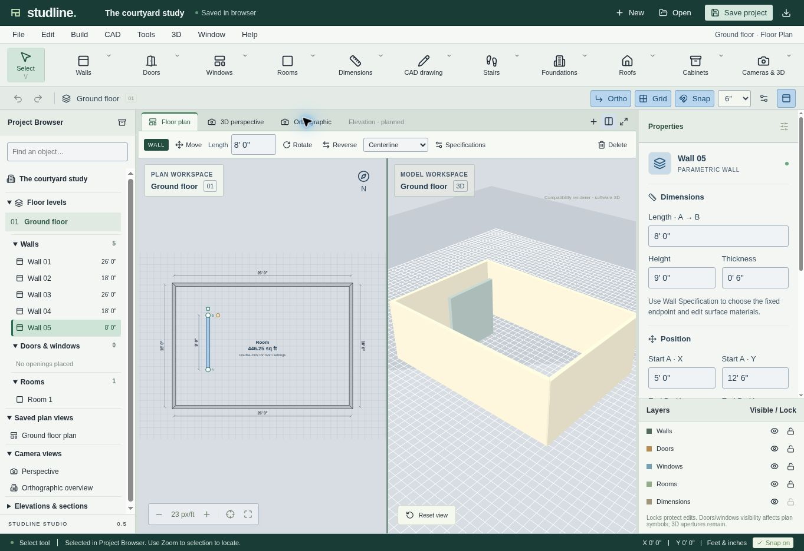

# Studline — Residential Design

A working foundation for an original residential CAD application. One parametric building model drives the floor plan and the 3D wall geometry.

## Run locally

Use Node.js 22.12+ or Node.js 24 (the build was tested on 24.19.0).

```sh
npm ci
npm run dev
```

Open http://localhost:4173. For a release build, run `npm run build`; the static application is written to `dist/`. No API key, database, or paid rendering service is required.

## Try v0.5

1. Open the application. It starts with a 24 × 18 foot example room, or restores the last project in that browser.
2. Click **New**, enter a project name and starting wall height/thickness, then click **Create project**.
3. Press **W** or choose **Walls → Straight wall**. Click and drag, or click a starting corner and immediately type a length such as `12' 6"`. **Tab** moves to heading; **Enter** places the wall. Keep clicking or typing for a continuous chain; **Esc** ends it. Projected alignment helps match earlier corners; endpoint snapping shares junction IDs. Amber endpoints indicate an open outline.
4. Press **V** and click a wall and choose **Specifications**, or click its dimension label. **Wall Specification → General** edits length, height, thickness, wall type, fixed endpoint and connected-corner behavior. **Materials** sets each side's finish (paint, siding, brick, stone, wood or plaster) and color. **Apply** commits without closing; **Cancel** discards unapplied changes. Double-click inside an enclosed room to name it, choose its type, show/hide its label, add notes and inspect calculated dimensions.
5. Choose **Door** or **Window**, then click an existing wall. Green/red previews indicate whether the default opening fits. Select the symbol to edit width, height, offset and window sill; drag it along its host. Door hinge and swing controls affect the plan symbol.
6. Click **3D perspective** to see actual wall apertures. Orbit with a left drag, pan with a right drag, zoom with the wheel. A software 3D renderer is automatically used if WebGL 2 is unavailable.
7. Click **Save project**. Close/reload the page or use **Open** to reopen it. Every committed edit also autosaves.
8. Use the download icon to **Export project JSON** for a portable backup. **Open → Import project JSON** reopens it under a new project ID, preserving existing saves.

For a dimensionally exact rectangle without drawing four segments, use **Rooms → Rectangular room** and enter width and depth. This creates the same four connected wall objects.

The `examples/20x16-room.studline.json` file is the original schema-1 browser export. `examples/20x16-openings.studline.json` is the v0.2 browser export with one door and one window. Both can be imported; old files migrate to schema 2 in memory. `examples/precision-recess.studline.json` is the v0.3 browser export after anchored dimension/thickness edits.

## Editing controls

| Control                          | Action                                          |
| -------------------------------- | ----------------------------------------------- |
| W                                | Draw connected walls                            |
| Number / L while drafting        | Begin exact length entry; Tab to angle; Enter places |
| D / N                            | Place door / window on an existing wall          |
| V                                | Select walls and junctions                      |
| Drag selected wall               | Parallel movement by default; Free translate available |
| A/B circles / square / gold handle | Endpoint / length / rotation about A |
| H or Space + drag                | Pan the 2D canvas                               |
| Wheel / + / −                    | Zoom                                            |
| M                                | Measure two points                              |
| Esc                              | End/cancel the current drawing chain            |
| Ctrl/Cmd + Z                     | Undo                                            |
| Ctrl/Cmd + Shift + Z or Ctrl + Y | Redo                                            |
| Delete / Backspace               | Delete selected wall or opening                 |
| Ctrl/Cmd + S                     | Save to browser storage                         |

Grid spacing, snapping, orthogonal drawing and dimension labels are configurable in Drawing preferences. The right panel can be collapsed for a larger canvas and starts collapsed on phone-sized screens.

Draft headings use plan coordinates: 0° right, 90° down, 180° left, 270° up. An explicitly typed heading overrides Ortho. Mouse endpoint snapping respects Ortho; toggle it off for free-angle drawing. Wall selection treats the wall as one object; dimension labels measure its centerline. Thickness expands equally on both sides. Length can keep A, B or the midpoint fixed. Body/endpoint edits preserve existing orthogonal corners when enabled. Rotation uses the gold handle about A and can tilt neighboring walls. Surface colors update in 3D; texture patterns and construction layers are not modeled.

The desktop workspace includes expandable tool groups, a searchable Project Browser, contextual editing, visibility and locking controls, and plan, perspective, and orthographic tabs. Use the split button to view the plan and model together. Resize the docks by dragging their dividers. Layout and saved plan layer presets persist in the browser.



See the [workspace audit and verification](docs/WORKSPACE_AUDIT.md) for the before/after comparison.

## What's implemented

- New, named, single-floor projects; saved project list; JSON import/export.
- Integer 1/64-inch coordinates, imperial/fractional/metric entry and imperial dimension labels.
- Grid, endpoint snapping, orthogonal drawing, zoom, pan and two-point measurement.
- Connected straight walls with shared junctions; two-wall miter corners.
- Exact draft length/heading; projected alignment guides; visible open endpoints and closure feedback.
- Wall-hosted doors/windows with validated offsets, sizes and sill heights; plan symbols and actual 3D voids.
- Whole-wall selection, wall specification dialogs, parallel/free dragging, endpoint/length/rotation handles and exact centered dimensions.
- Atomic contextual numeric edits, orthogonal connected-node constraints, fixed walls and interior/exterior surface finishes.
- Reversible commands with 100-step undo/redo; autosave and last-valid-save recovery.
- Shared footprint extrusion in Three.js; WebGL/R3F renderer and software SVG renderer with orbit/pan/zoom.
- Actual interior polygon areas for standalone and adjoining rooms, room name/type/notes, interior label points, total wall length and validation errors.
- Schema-1 migration with preserved geometry and object IDs; schema-2 opening, room and finish persistence.

## Validation

```sh
npm run check
```

This runs ESLint, Vitest tests, strict TypeScript compilation, and the Vite production build. See `docs/VERIFICATION.md` for browser checks and limits. Tests cover actual mesh volume/rays through openings, connected edits, miter corners, welding, exact units, ortho/alignment regression, zoom anchoring, command reversal, migrations and save recovery. The original 30 tests remain unchanged.

## Current boundaries

- One floor with straight walls. Rooms are extracted from enclosed wall faces, including adjoining rooms. Room polygons support a single boundary, so nested enclosures and holes remain unsupported.
- Orthogonal constraints propagate existing horizontal/vertical equalities; they are not a general-angle constraint solver. Angle edits/free editing may intentionally tilt adjacent walls. Face solves reject unsupported configurations.
- Wall edits split T- and X-junctions and consolidate compatible collinear overlaps. Multi-wall render footprints use butt joins; unioned wall meshes remain future work.
- Wall classifications are not layered assemblies. Dimension labels are editable derived measurements, not persistent dimension objects.
- The ground grid in 3D is a viewing aid, not a floor assembly. No orthographic/elevation view yet.
- Browser storage is device/origin-specific and can be cleared. Export JSON backups for important work. There is no account-based project synchronization yet.
- Command history, workspace preferences and new-wall defaults are session-local; saved wall/opening geometry persists.
- The software renderer is visually tested here. GPU/WebGL rendering could not be visually tested because the test browser disables WebGL; it compiles and uses the same tested triangle meshes. SVG rendering uses painter ordering and may show occlusion artifacts in complex overlapping designs.
- Apertures have no 3D leaf, frame, glass or casing; minimum wall clearances are geometric validation, not structural design. Overlapping/stacked openings are not supported.
- Software-rendered apertures can show shading seams; mesh portions retain internal touching faces. GPU rasterization remains unverified in this browser.
- No roofs, stairs, framing, construction sheets, AI actions, or code/structural verification are implemented. Output is preliminary design work.

## Architecture and next milestone

Read `docs/ARCHITECTURE.md` for schema, coordinates, module boundaries, state and persistence. [DEVELOPMENT_STATUS.md](DEVELOPMENT_STATUS.md) contains the verified inventory and defects; [SCREEN_RECORDING_REVIEW.md](SCREEN_RECORDING_REVIEW.md) records timestamped findings. Multi-wall mesh unions and room surfaces remain future work. [ROADMAP.md](ROADMAP.md) defines acceptance gates and [CHANGELOG.md](CHANGELOG.md) records this increment. AI integration should follow these model rules, behind a server-side credential boundary, with validated command previews.

The dedicated Sites source repository tracks this project. `.openai/hosting.json` holds its identity and private static-hosting configuration. Do not create a second Site when continuing development.
